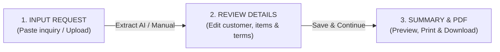

# QuoteFlow AI — Project Summary

**QuoteFlow AI** is a modern, responsive 3-step web application that transforms raw customer inquiry messages (emails, WhatsApp chats, plain text) into formatted, professional sales quotations and print-ready PDF documents using AI-assisted extraction and dynamic price calculations.

---

## 🚀 Quick Start & How to Run

To run the application locally:

1. **Launch Server**:
   ```bash
   node server.js
   ```
2. **Access in Browser**:
   - Open **`http://localhost:3005/`**
   - Main Entry Page: [QuoteFlow_AI_Quotation_Builder.html](file:///c:/Users/admin/Desktop/Quatation/QuoteFlow_AI_Quotation_Builder.html)

---

## 🛠️ Architecture & Tech Stack

- **Frontend**: HTML5, Vanilla JavaScript (ES6+), Tailwind CSS (via CDN) with custom theme extensions (`tailwind-theme.js`).
- **Icons & Typography**: Google Material Symbols Outlined & Inter font family.
- **Backend / Web Server**: Zero-dependency Node.js HTTP server (`server.js`) listening on port `3005`.
- **AI Integration**: Google Gemini 3.6 Flash REST API (`generateContent`) for intelligent structured entity extraction from raw text inquiries, with a regex fallback.
- **State Management**: Client-side single source of truth saved in `localStorage` under key `QuoteFlow_Data`.

---

## 📋 3-Step Application Workflow



### 1. Step 1: Input Request (`QuoteFlow_AI_Quotation_Builder.html`)
- **Purpose**: Intake raw customer inquiry messages.
- **Features**:
  - Clean, un-cluttered empty textarea ready for user input.
  - **Paste Button**: One-click clipboard pasting using `navigator.clipboard.readText()`.
  - **AI Extract Details Button**: Calls Gemini AI to extract customer name, email, phone, billing address, line items, and quantities.
  - **Upload File & Enter Manually Options**: Supports manual entry or document upload simulation.

### 2. Step 2: Review Details (`Step_2_Review_Details.html`)
- **Purpose**: Inspect and modify customer details, quotation information, line items, and terms.
- **Features**:
  - **Customer Info Section**: Edit company name, contact person, email, phone, billing address, and GSTIN. Pencil icon button toggles focus and edit mode.
  - **Interactive Items Table**: Add new blank item rows, duplicate existing rows, or delete rows.
  - **Real-Time Price Calculations**: Automatically recalculates subtotals, GST (18%), discounts, and grand totals upon typing.
  - **Currency Switcher**: Supports INR (₹), USD ($), and EUR (€) with dynamic currency formatting.
  - **Persistence**: "Back to Input", "Save Draft", and "Continue to Summary" all synchronize DOM edits directly to `localStorage`.

### 3. Step 3: Summary & PDF Generation (`Step_3_Summary_PDF.html`)
- **Purpose**: Render the final A4 quotation sheet for client review and printing.
- **Features**:
  - **Summary Card & Checklist**: Shows reference numbers, grand totals, and pre-flight validation status.
  - **PDF Preview Sheet**: Pixel-perfect A4 printable layout showing company header, bill-to address, line items table, GST breakdown, and signature block.
  - **Toolbar Controls**: Zoom In / Zoom Out document preview, Share URL link, Print document (`window.print()`), and Download PDF.

---

## 🌟 Key Application Features

| Feature | Description | File Location |
| :--- | :--- | :--- |
| **Toast Notifications** | Non-intrusive floating toast UI replacing native browser alerts | [scripts.js](file:///c:/Users/admin/Desktop/Quatation/scripts.js#L5-L26) |
| **State Synchronization** | Shared `getState()` and `saveState()` methods across all pages | [scripts.js](file:///c:/Users/admin/Desktop/Quatation/scripts.js#L30-L65) |
| **AI Entity Extraction** | Calls Gemini 3.6 Flash to parse raw text into structured JSON | [scripts.js](file:///c:/Users/admin/Desktop/Quatation/scripts.js#L146-L235) |
| **Clipboard Utility** | One-click clipboard pasting with browser permission fallback | [scripts.js](file:///c:/Users/admin/Desktop/Quatation/scripts.js#L252-L277) |
| **ID-based DOM Rendering** | Clean element updates preventing layout corruption on Step 3 | [Step_3_Summary_PDF.html](file:///c:/Users/admin/Desktop/Quatation/Step_3_Summary_PDF.html#L50-L200) |

---

## 📁 File Structure Summary

```
c:\Users\admin\Desktop\Quatation\
├── QuoteFlow_AI_Quotation_Builder.html  # Step 1: Input Request Page
├── Step_2_Review_Details.html           # Step 2: Review & Edit Details Page
├── Step_3_Summary_PDF.html              # Step 3: Summary PDF Preview Page
├── scripts.js                           # Core JS Application Logic & Event Handlers
├── server.js                            # Local Node HTTP Server (Port 3005)
├── tailwind-theme.js                    # Tailwind CSS Custom Configuration & Tokens
├── PROJECT_SUMMARY.md                   # Project documentation
├── AGENTS.md                            # Agent workspace configuration
├── package.json                         # Package dependencies
└── utility scripts (clean_classes.js, extract_config.js, insert_sample_data.js, etc.)
```

---

*Documentation compiled for QuoteFlow AI.*
